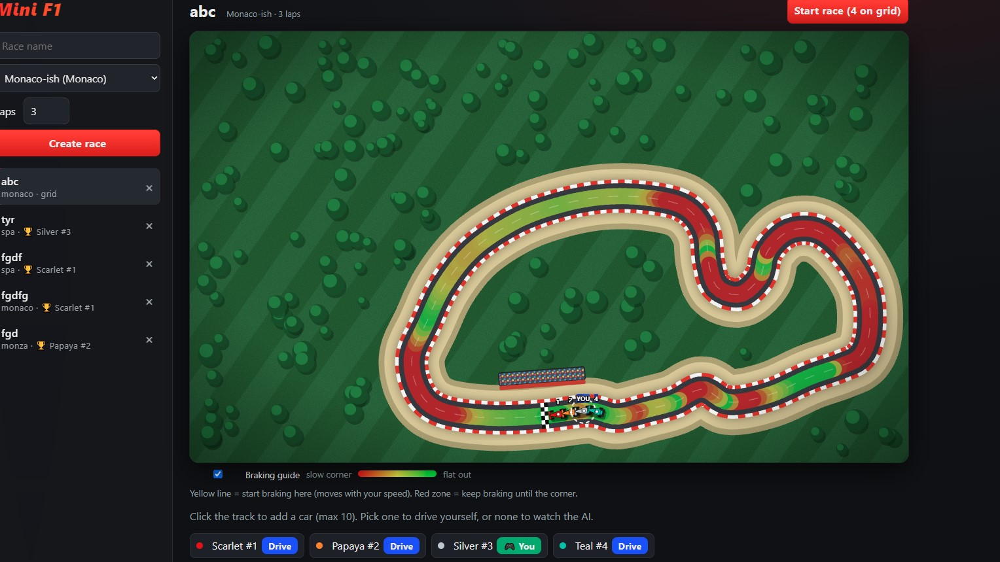
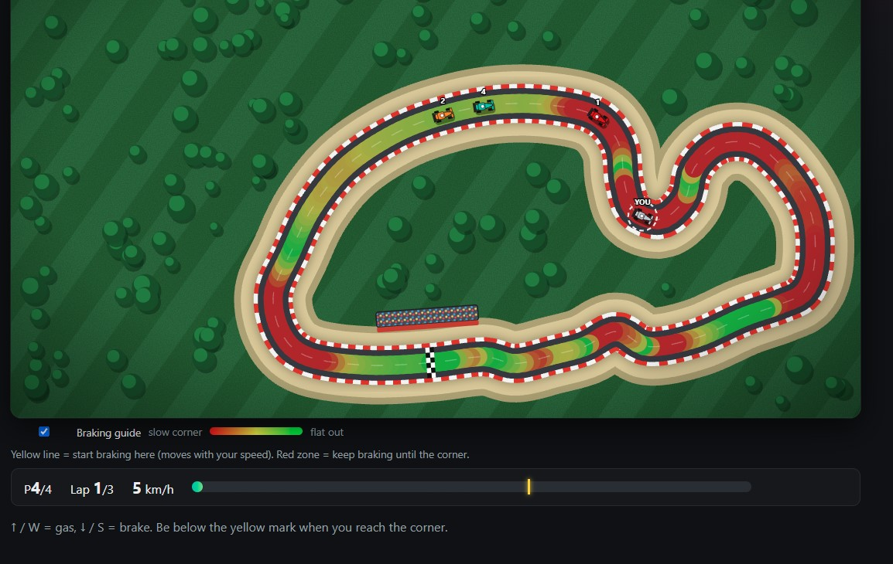
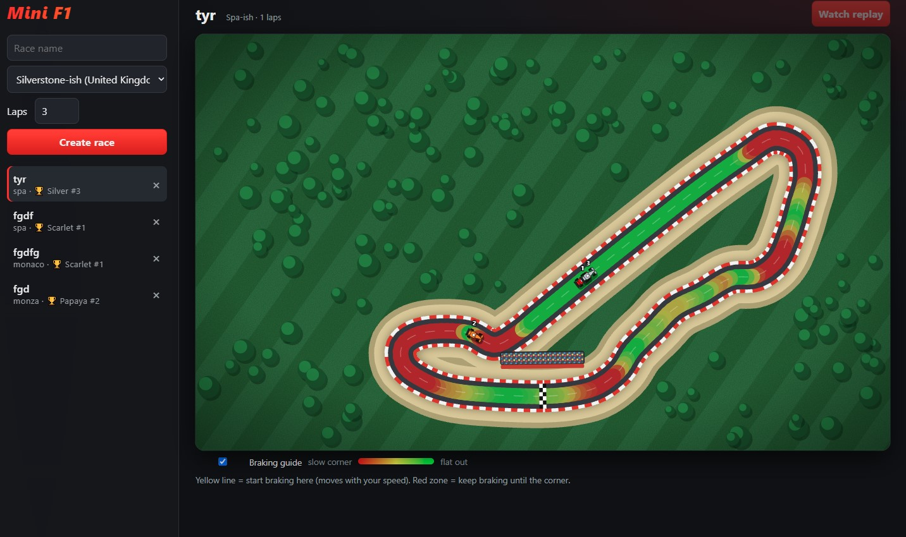
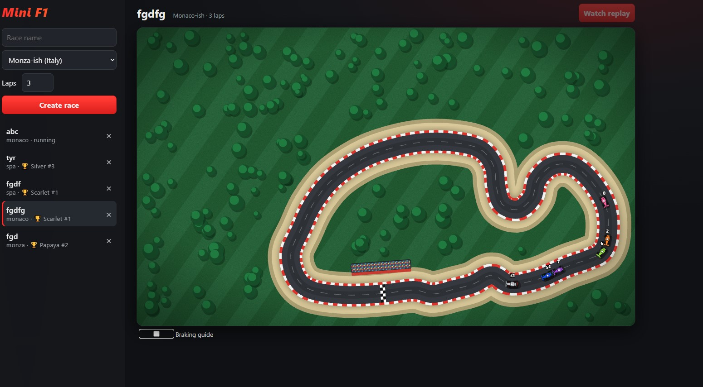

# Mini F1 (Django + React)

Top-down F1 race game. Django REST Framework API + React (Vite) front end.

## Run

Backend (http://127.0.0.1:8000):

    cd backend
    python -m venv .venv && source .venv/bin/activate
    pip install -r requirements.txt
    python3 manage.py makemigrations races   # re-run after updating: models changed
    python3 manage.py migrate
    python3 manage.py runserver   # Daphne (ASGI) serves both HTTP and WebSockets

Frontend (http://localhost:5173, proxies /api to Django):

    cd frontend
    npm install
    npm run dev -- --host

## API

| Method | URL | What |
|---|---|---|
| GET | /api/tracks/, /api/tracks/<key>/ | Premade tracks (centerline path, start line) |
| GET/POST | /api/races/ | List / create race `{name, track, laps}` |
| GET/DELETE | /api/races/<id>/ | Race with competitors and results |
| POST | /api/races/<id>/competitors/ | `{x, y}` track click -> adds one car on the next grid slot |
| POST | /api/races/<id>/player/ | `{competitor: id}` the car the human drives (`null` = AI only) |
| POST | /api/races/<id>/start/ | With a player: status `running`. Without: simulates the whole race at once |
| WS | /ws/races/<id>/ | Live race: client sends `{throttle}` on key changes, server pushes a tick every 50 ms (see `races/consumers.py`) |
| GET | /api/races/<id>/replay/ | Per-tick car positions used by React to animate |

The race is simulated on the server. For interactive races React opens a WebSocket (Django Channels, no Redis
needed), sends the throttle only when a key changes (Up/W gas, Down/S brake), and the server pushes the state at
20 Hz after a 3-2-1 countdown. The browser blends between ticks so it renders smoothly. Every car has a corner speed
limit; the player spins out if they carry too much speed into a corner (the yellow HUD mark shows the safe speed for
the next ~100 units). Leaving mid-race keeps the race resumable. Without a player the whole race is simulated at once
by `POST /start/` and React plays back the returned replay.

`GET /api/tracks/` also returns `safe` (player's safe speed at each path point), `step` and `brake`. React uses them
for the braking guide: a red-to-green corner-speed heat map on the asphalt, plus a live yellow line (red when you must
brake right now) showing where braking has to start for your current speed, with the target speed for the corner.

### Driver selection

### Racce

### Replay

### Without braking guide

